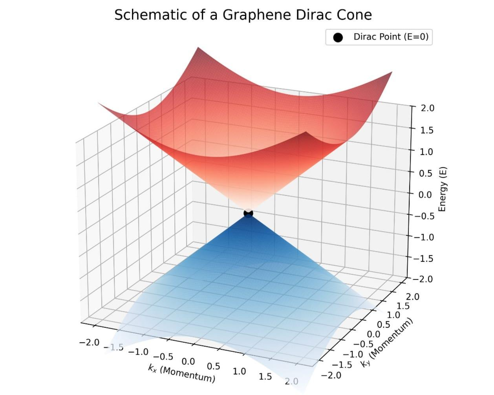
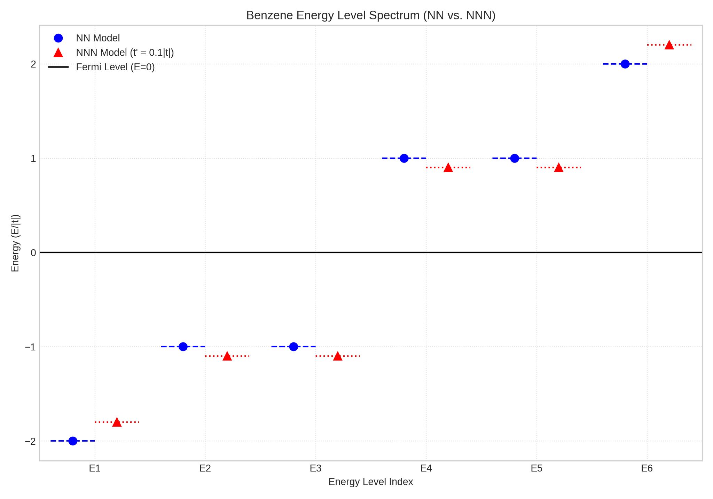
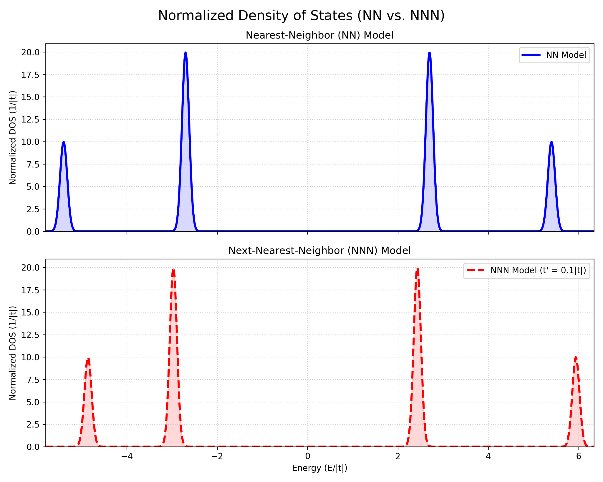
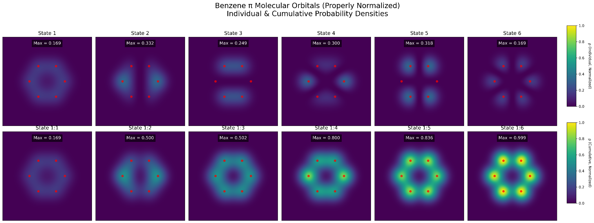
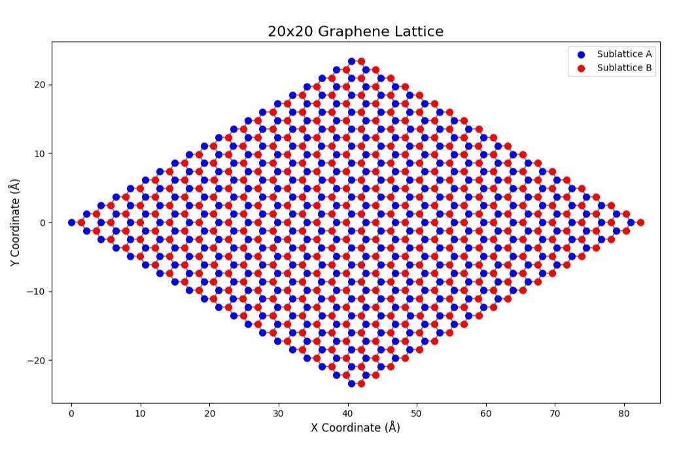
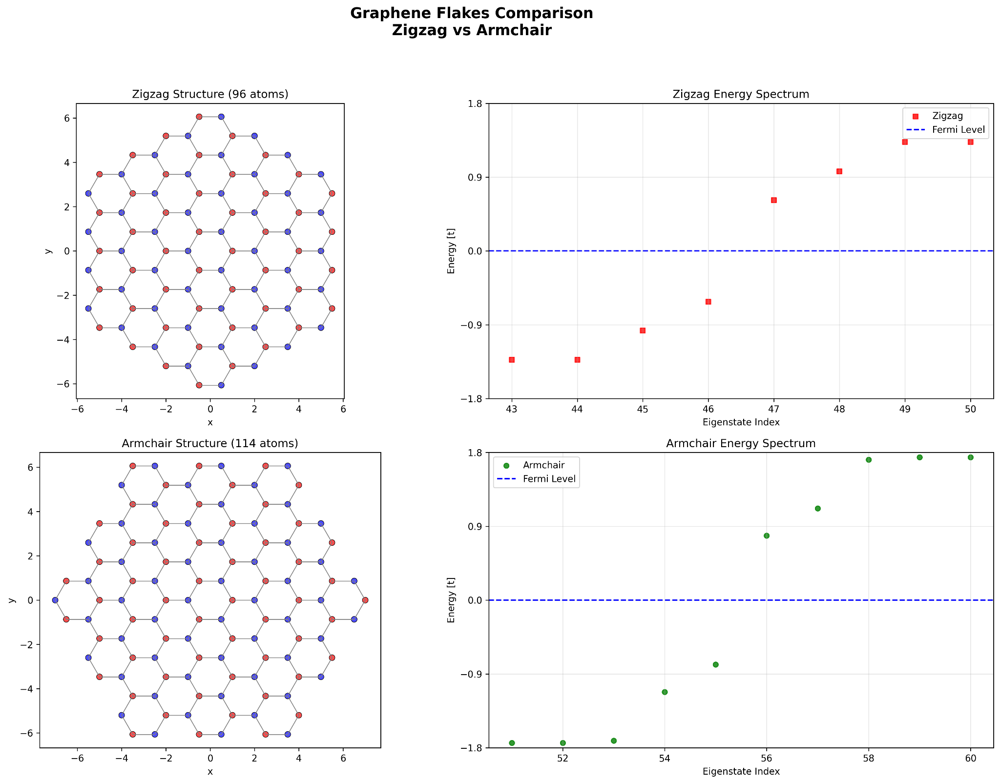

# Electronic Structure of Benzene and Graphene: Band Structure & Edge Effects

**A Python-based computational study of the electronic structures of benzene and graphene using the Tight-Binding (TB) model, including molecular orbitals, energy spectra, density of states, Dirac cones, and graphene edge effects.**

> **Research Internship Project | September 2025**
>
> **Institution:** İzmir Institute of Technology (IZTECH), Türkiye
>
> **Author:** Cevdet Zafer Osmanağaoğlu
>
> **Research Paper:** *Electronic Structure of Benzene and Graphene: A Tight-Binding Analysis with Nearest and Next-Nearest Neighbour Interactions*
>
> The accompanying research paper is available in the [`paper/`](paper/) directory.

---

## 📌 Overview

This repository contains the Python simulation codes and visualizations developed during a research internship at **İzmir Institute of Technology (IZTECH)** in September 2025.

The project investigates and compares the electronic properties of **benzene (C₆H₆)** and **graphene** using the Tight-Binding (TB) approximation within the Linear Combination of Atomic Orbitals (LCAO) framework.

The study explores the relationship between finite molecular systems and extended crystalline structures, emphasizing how atomic connectivity, hopping interactions, dimensionality, and boundary geometry influence electronic behavior.

Both nearest-neighbour (NN) and next-nearest-neighbour (NNN) interactions are considered where applicable. Numerical calculations are complemented by schematic visualizations illustrating fundamental concepts in electronic band theory.

### Research Objectives

- **Benzene:** Investigate discrete π-molecular orbitals, energy eigenvalues, degeneracies, and density of states.
- **Graphene:** Illustrate the honeycomb crystal lattice, sublattice geometry, linear dispersion, and Dirac-cone structure.
- **NN and NNN Interactions:** Examine how longer-range hopping modifies energy spectra and electronic symmetry.
- **Quantum Confinement:** Compare the electronic properties of finite graphene structures with different boundary geometries.
- **Edge Effects:** Explore zigzag and armchair graphene flakes through their atomic structures and eigenvalue spectra.
- **Size–Gap Relationship:** Illustrate the inverse-width dependence of energy gaps and the three-family classification associated with armchair graphene nanoribbons.

The repository provides the computational implementations, generated figures, and execution instructions associated with the research paper.

---

## 🗂️ Repository Structure

- **`appendix_code/`** - Python implementations associated with the paper's appendices.
  - `fig5_dirac_cone.py` - Schematic graphene Dirac cone.
  - `band_structures.py` - Schematic electronic band structures.
  - `benzene_tight_binding.py` - Benzene energy spectra, density of states, molecular orbitals, and graphene lattice.
  - `zigzag_vs_armchair.py` - Graphene flake geometries and eigenvalue spectra.
  - `size_gap_relationship.py` - Illustrative ribbon-width versus energy-gap relationship.
- **`figures/`** - Generated PNG visualizations.
- **`paper/`** - Accompanying research paper in PDF format.
- **`LICENSE`** - MIT License.
- **`README.md`** - Project documentation.

---

## 📊 Figures and Code Mapping

The following table maps the eight appendix-code figures to their Python implementations and generated output files.

The *Appendix Figure* numbering follows the sequence of code examples, whereas the *Paper Figure* numbering refers to the corresponding figures in the main research paper.

| Appendix Figure | Paper Figure | Description | Python Script | Output |
|---|---|---|---|---|
| **Fig. 1** | Fig. 1 | Schematic 3D graphene Dirac cone | `fig5_dirac_cone.py` | `fig5_dirac_cone.png` |
| **Fig. 2** | Fig. 2 | Schematic electronic band structures | `band_structures.py` | `band_structures.png` |
| **Fig. 3** | Fig. 3 | Benzene energy spectrum: NN vs. NNN | `benzene_tight_binding.py` | `fig1_combined_spectrum.png` |
| **Fig. 4** | Fig. 6 | Gaussian-broadened benzene density of states | `benzene_tight_binding.py` | `fig2_combined_dos.png` |
| **Fig. 5** | Fig. 4 | Benzene π-molecular orbital probability densities | `benzene_tight_binding.py` | `fig3_benzene_orbitals.png` |
| **Fig. 6** | Fig. 5 | Graphene honeycomb crystal lattice | `benzene_tight_binding.py` | `fig4_graphene_lattice.png` |
| **Fig. 7** | Fig. 7 | Zigzag and armchair flake comparison | `zigzag_vs_armchair.py` | `zigzag_vs_armchair_comparison.png` |
| **Fig. 8** | Fig. 8 | Illustrative size–energy-gap relationship | `size_gap_relationship.py` | `fig8_size_gap_relationship.png` |

**Note:** The figure numbering in the code appendices differs from that used in parts of the main paper. In particular, the DOS script associated with Appendix Fig. 4 calculates the spectrum of a finite six-site benzene model, rather than a full periodic graphene DOS.

---

## 🖼️ Key Visualizations

### Fig. 1 - Dirac Cone in Graphene

A schematic three-dimensional representation of the Dirac cone near a graphene K-point.

The plot illustrates the approximately linear energy–momentum dispersion of the conduction (π*) and valence (π) bands, which meet at the Dirac point in the nearest-neighbour approximation.

### Fig. 2 - Schematic Electronic Band Structures

A qualitative comparison of four electronic band-structure categories:

- Metal
- Semiconductor
- Insulator
- Semi-metal (graphene)

The visualization illustrates the relationship between occupied and unoccupied electronic bands, band gaps, and the Fermi-energy reference.

### Fig. 3 - Benzene Energy Levels: NN vs. NNN

Comparison of the six π-electron energy levels of benzene using nearest-neighbour and next-nearest-neighbour tight-binding Hamiltonians.

The calculations employ a six-site cyclic model with hopping parameters:

- Nearest-neighbour hopping: **t = −2.7 eV**
- Next-nearest-neighbour hopping: **t′ = 0.1|t| = 0.27 eV**

Including NNN hopping shifts the eigenenergies and modifies the level spacings. For an ideal uniform benzene ring, the symmetry-related twofold degeneracies remain preserved.

### Fig. 4 - Density of States: NN vs. NNN

A comparison of the Gaussian-broadened density of states (DOS) obtained from the discrete energy eigenvalues of the six-site benzene Hamiltonian.

The figure illustrates changes in peak positions and spectral distributions when next-nearest-neighbour hopping interactions are included.

### Fig. 5 - Benzene π-Molecular Orbitals

Visualization of benzene π-molecular orbital probability densities using the Linear Combination of Atomic Orbitals (LCAO) approximation.

The upper panels represent individual molecular orbital probability densities, while the lower panels show cumulative contributions from successive orbitals.

The spatial orbital representations are constructed using localized Gaussian functions for visualization.

### Fig. 6 - Graphene Crystal Lattice

A computational visualization of graphene's two-dimensional honeycomb lattice, constructed from two interpenetrating triangular sublattices.

- **Sublattice A:** Blue atoms
- **Sublattice B:** Red atoms
- **Lattice dimensions:** 20 × 20 unit cells

The figure illustrates the bipartite atomic arrangement and nearest-neighbour connectivity characteristic of graphene.

### Fig. 7 - Edge Effects: Zigzag vs. Armchair

A comparison of finite graphene flakes with zigzag and armchair edge geometries.

The figure presents the atomic arrangements and corresponding energy eigenvalue spectra near the zero-energy reference.

The finite-flake Hamiltonians are constructed using **nearest-neighbour hopping only**, and the spectra are obtained through sparse-matrix eigensolvers.

The comparison illustrates how finite-size confinement and edge geometry influence low-energy electronic states.

### Fig. 8 - Size–Energy-Gap Relationship

A schematic representation of the relationship between graphene nanostructure width and electronic energy gap.

The armchair model illustrates an approximately inverse-width dependence:

**E_gap ∝ 1/W**

The visualization also introduces the three width-dependent families commonly associated with armchair graphene nanoribbons:

- N = 3m
- N = 3m + 1
- N = 3m + 2

The zigzag reference curve is represented as gapless within the simplified illustrative model.

**Scientific clarification:** This figure uses a phenomenological inverse-width relationship and synthetically generated data points with added random noise. The plotted points are not experimental measurements from Han et al. (2007), nor are they obtained from direct tight-binding diagonalization for each ribbon width.

The illustration is conceptually motivated by the literature on graphene nanoribbon band-gap engineering.

---

## 🛠️ Computational Methods

### Programming Environment

- **Language:** Python 3.11
- **Numerical Computation:** NumPy
- **Scientific Visualization:** Matplotlib
- **Sparse Linear Algebra:** SciPy

### Theoretical Framework

The computational analysis is based on the following concepts:

**1. Tight-Binding Approximation**

Electronic interactions are modeled through hopping integrals between localized atomic orbitals.

The model includes nearest-neighbour interactions and, for the benzene comparison, next-nearest-neighbour terms.

**2. Linear Combination of Atomic Orbitals (LCAO)**

Molecular electronic states are represented through superpositions of localized atomic orbitals.

**3. Hamiltonian Matrix Construction**

Finite electronic systems are represented by Hamiltonian matrices whose eigenvalues and eigenvectors describe the corresponding energy spectra and electronic states.

**4. Density of States**

Discrete energy spectra are represented through Gaussian-broadened distributions for numerical visualization.

**5. Sparse Matrix Diagonalization**

Sparse Hamiltonian representations and eigensolvers are used for finite graphene flakes.

**6. Quantum Confinement and Edge Geometry**

The electronic consequences of finite system size and boundary configuration are investigated through comparative model geometries and low-energy spectra.

---

## 🚀 Getting Started

### Prerequisites

Install Python 3.11 and the required dependencies.

Run the following command in your terminal:

`pip install numpy matplotlib scipy`

### Running the Simulations

Clone or download the repository and navigate to the source-code directory:

`cd appendix_code`

Execute the following scripts independently.

**Fig. 1 - Graphene Dirac Cone**

`python fig5_dirac_cone.py`

**Fig. 2 - Schematic Band Structures**

`python band_structures.py`

**Figs. 3–6 - Benzene and Graphene Visualizations**

`python benzene_tight_binding.py`

**Fig. 7 - Zigzag vs. Armchair Flakes**

`python zigzag_vs_armchair.py`

**Fig. 8 - Size–Gap Relationship**

`python size_gap_relationship.py`

### Output Files

The simulations generate graphical visualizations using Matplotlib. The figures included in this repository are stored in the [`figures/`](figures/) directory.

**Important execution notes:**

- In the original appendix implementation, `band_structures.py` displays the figure without automatically saving a PNG file. Add an appropriate `plt.savefig()` command if regenerating the image.
- The original `zigzag_vs_armchair.py` script saves its output to the user's `~/Desktop` directory. This location may need to be adjusted for other systems.
- Other scripts generally write their output images to the current working directory.

Generated images can be copied into `figures/` to update the README previews.

---

## 🔬 Scope and Scientific Limitations

This repository combines numerical tight-binding calculations with schematic visualizations. These should be distinguished when interpreting the figures.

- The benzene energy spectra are obtained from explicit finite Hamiltonian diagonalization.
- The molecular orbital and DOS figures use simplified numerical representations.
- The Dirac-cone and material band-structure illustrations are schematic rather than complete momentum-resolved graphene band calculations.
- The finite graphene flake comparison uses NN hopping without explicit NNN terms.
- The size–gap visualization is an illustrative model using synthetic data rather than experimentally acquired measurements.
- The qualitative electronic behavior of graphene nanostructures may depend on edge geometry, ribbon width, finite-size effects, boundary conditions, and interactions beyond the simplified models.

The primary purpose of the project is to provide a computational and conceptual introduction to the electronic structures of hexagonal carbon systems.

---

## 📚 Selected References

1. Castro Neto, A. H., Guinea, F., Peres, N. M. R., Novoselov, K. S., & Geim, A. K. (2009). *The electronic properties of graphene.* Reviews of Modern Physics, 81, 109–162. https://doi.org/10.1103/RevModPhys.81.109

2. Wallace, P. R. (1947). *The band theory of graphite.* Physical Review, 71, 622–634. https://doi.org/10.1103/PhysRev.71.622

3. Reich, S., Maultzsch, J., Thomsen, C., & Ordejón, P. (2002). *Tight-binding description of graphene.* Physical Review B, 66, 035412. https://doi.org/10.1103/PhysRevB.66.035412

4. Nakada, K., Fujita, M., Dresselhaus, G., & Dresselhaus, M. S. (1996). *Edge state in graphene ribbons: Nanometer size effect and edge shape dependence.* Physical Review B, 54, 17954. https://doi.org/10.1103/PhysRevB.54.17954

5. Son, Y.-W., Cohen, M. L., & Louie, S. G. (2006). *Energy gaps in graphene nanoribbons.* Physical Review Letters, 97, 216803. https://doi.org/10.1103/PhysRevLett.97.216803

6. Han, M. Y., Özyilmaz, B., Zhang, Y., & Kim, P. (2007). *Energy band-gap engineering of graphene nanoribbons.* Physical Review Letters, 98, 206805. https://doi.org/10.1103/PhysRevLett.98.206805

Additional references and theoretical background are provided in the accompanying research paper.

---

## 📄 Research Paper

**Title:** Electronic Structure of Benzene and Graphene: A Tight-Binding Analysis with Nearest and Next-Nearest Neighbour Interactions

**Author:** Cevdet Zafer Osmanağaoğlu

**Institution:** İzmir Institute of Technology (IZTECH)

**Research Period:** September 2025

**Project Type:** Research Internship (STAJ-S1)

The paper presents the theoretical background, computational methodology, numerical results, and discussion associated with this repository.

The Python implementations are provided separately to facilitate code inspection, independent execution, and reproducibility.

The research paper is available in the [`paper/`](paper/) directory.

---

## 📄 License

This project is distributed under the **MIT License**.

See [LICENSE](LICENSE) for additional information.

---

## 👤 Author

**Cevdet Zafer Osmanağaoğlu**

Physics Undergraduate - Ege University, Türkiye

Research Internship Project - İzmir Institute of Technology (IZTECH), September 2025

**Research Interests:** Quantum Physics, Quantum Computing, Computational Physics, and Theoretical Modeling.

---

*This repository documents a computational research project conducted during an undergraduate research internship in September 2025. It is intended for academic reference, educational use, and reproducible computational exploration.*
